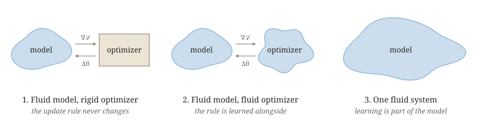

## How should models learn?

Recently I've been down an interesting subtopic of optimizer research called 'meta-optimization', or simply put, replacing static, offline learning with an ever-evolving neural network that can assign the best fix for each parameter.

Going back as far as Schmidhuber's [thesis](https://people.idsia.ch/~juergen/diploma1987ocr.pdf), researchers have pursued meta-optimization because first- and second-order methods, while scalable and simple, are expensive and often rigid for a given problem.

Fundamentally, these methods are also at odds with how our brain learns, which is able to improve HOW it learns through exposure to the domain. Neuroplasticity lets us adapt as we're exposed to life, our own messy dataset, where we continuously improve through a feedback loop. Domain experts, to give an example, create unique methods to learn their field's information at a much faster pace, and I think such ideas should translate to how neural networks learn. One can argue cases like lr-decay, but those are like a rigid clock, and not fluid or adapatable. 

Many works have explored meta-optimizers ([Moudgil et al. (2026)](https://arxiv.org/abs/2602.19142), [Thérien et al. (2026)](https://arxiv.org/html/2406.00153v5), [Maoutsa (2025)](https://arxiv.org/abs/2512.09366), [Singh et al. (2025)](https://arxiv.org/abs/2508.09069), [Moudgil et al. (2025)](https://arxiv.org/abs/2501.12670), [Carrasco-Davis et al. (2023)](https://arxiv.org/abs/2310.19919), [Shervani-Tabar et al. (2023)](https://arxiv.org/html/2210.16414v5), [Metz et al. (2022)](https://arxiv.org/abs/2211.09760), [Feng et al. (2022)](https://arxiv.org/abs/2209.06259)). These works meta-learn meta-optimizers through either backprop, ES or policy gradients, and so far none have scaled to practical use.

Much of this work seems promising to me because it leads to a more solid definition of intelligence: an ever-evolving learning ability, not pre-defined offline methods. Approaches so far replace hand-coded update rules like Adam or SGD, but still rely on backprop to train the optimizer (e.g.[Metz et al. (2022)](https://arxiv.org/abs/2211.09760)), we're unable to find generalizable solutions. Outside of meta-optimizers, other methods include the [Forward-Forward algorithm by Hinton](https://www.cs.toronto.edu/~hinton/FFA13.pdf) and, more recently, perturbations (as done to weights or [activations](https://qlabs.sh/research/dust#activation-space-perturbation)).

It's unclear what the best framework is for producing a much more efficient method, since there is little knowledge about the shape, architecture and method needed to make this possible! Some examples include a framework to explain how different shapes/architectures work under these regimes, and theoretical bounds for their behavior. A good start is taking existing systems, trying to ground this idea there, and seeing what works, what doesn't and why!

All in all, this comes from a naive perspective of the field, but nonetheless optimistic that it will bring us closer to a unified brain-like intelligence. If this sounds interesting in anyway, my dms/emails are open!
